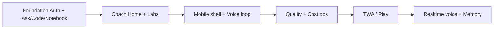

# Product Roadmap — My Student Coach

Horizon dates are product phases, not calendar estimates. Sequencing reflects merged work May–Nov 2026 and the next engineering slices.

## Now (shipped on `main`)

| Theme | Outcome | Evidence |
|-------|---------|----------|
| Student AI wedge | Hub focused on Ask / Code / Notebook | PR #64 remove Finance AI |
| Coach Home | Phase-1 home dashboard | PR #68 |
| P1 labs | Voice, Vision, Flashcards, Math, Focus, Gaps | PR #69 |
| UX simplification | Login gateway, teal coach brand, menus | PR #70–#73 |
| Android-simple P0 | Bottom nav, personalization, chat controls | PR #74 |
| Conversational voice | Stream + speak-early + barge-in + voiceMode | PR #74 |
| Hardening | Safari `activeChatAbort` declaration | PR #75 |

## Next

| Theme | Outcome | Dependencies |
|-------|---------|--------------|
| Quality loop ops | Weekly thumbs review → one shipped contract fix | Supabase service role + review SQL |
| Cost dashboard | Export HF usage + cache hit rate into `04-ai-cost-claims` | HF billing API / CSV |
| Notebook multi-file polish | Stronger source attribution in UI | Existing corpus builder |
| Practice under topic | Topic-scoped practice from Ask | Practice loop already in Code/Ask |
| TWA / Play packaging | Trusted Web Activity shell | Stable HTTPS domain + DigiCert |

## Later

| Theme | Outcome |
|-------|---------|
| Native realtime voice | Provider STT/TTS or WebRTC tutor |
| Teacher / classroom mode | Shared decks, anonymized class gaps |
| Memory vault (opt-in) | Cross-session learner memory with explicit consent |
| Workspace connectors | Google Drive notes → Notebook |

## Explicitly not on roadmap

Finance AI, Neo Clouds marketplace inside Student Hub, Privacy Agent as primary Hub tile.

## Roadmap diagram

