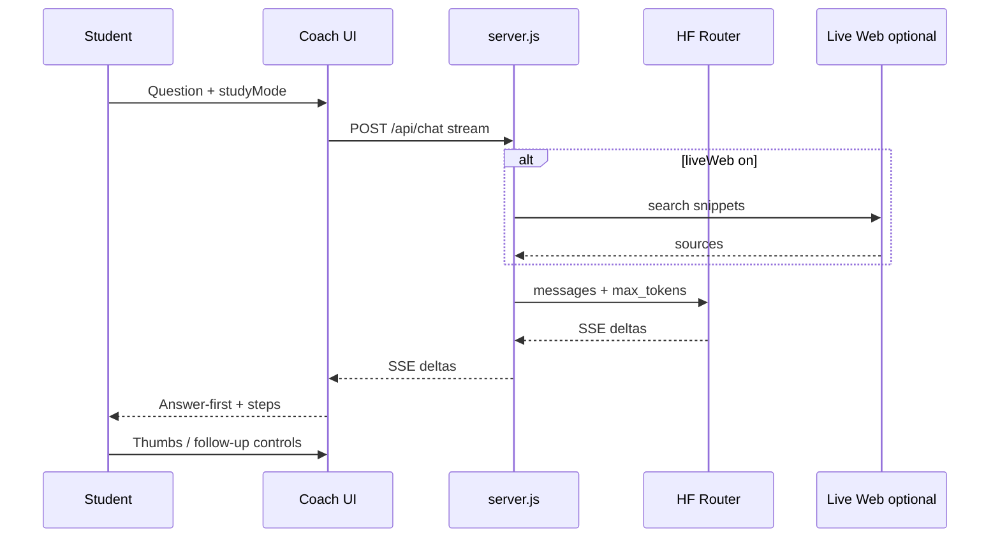
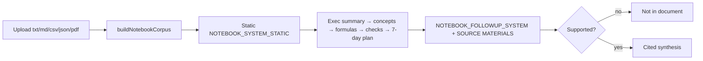
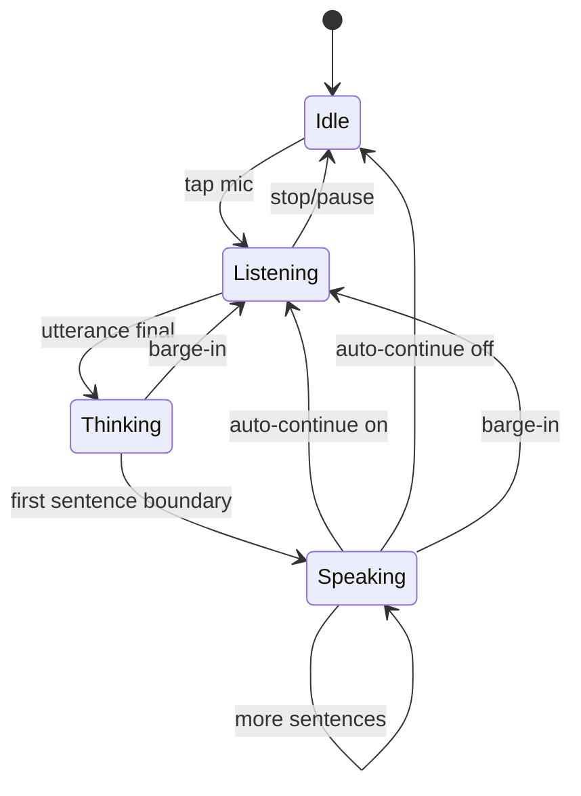
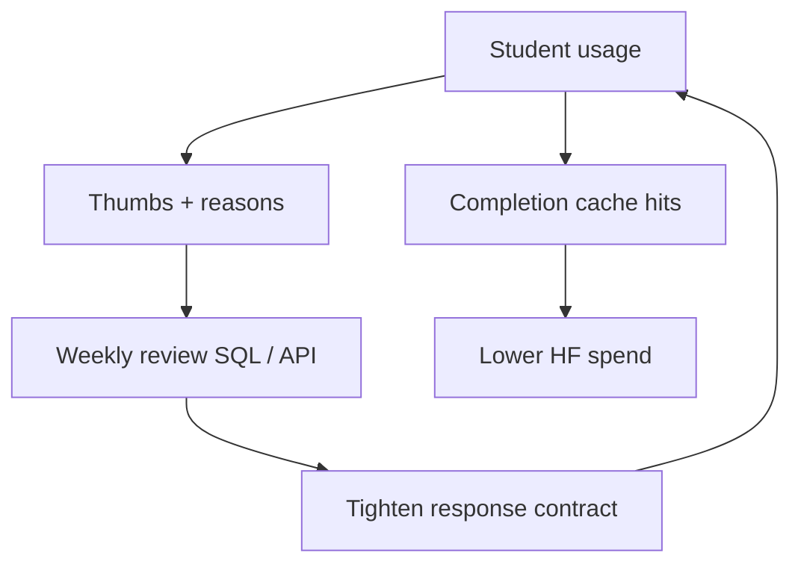

# AI Workflow Designs

## 1. Ask / Learn — teach the smallest useful next step

**Design choices:** Answer-first contract; Explain/Guide/Quiz styles; optional live web; regenerate and “explain simply” controls without new page.

## 2. Notebook — grounded multi-file study

**Design choices:** Static system prefix for cache friendliness; document-only truth; structured analyze sections; follow-ups cannot invent facts.

## 3. Code tutor + practice

- System: patient coding tutor + code fences only for code.  
- Practice loop: check / skip under replies (shipped under Code; Ask parity).  
- Guide mode blocks full submittable solutions.

## 4. Voice Tutor — almost conversational

**Design choices:** `voiceMode` short replies; speak-early; barge-in aborts fetch + TTS session id; Chrome/Edge preferred.

## 5. Quality / cost control loop

