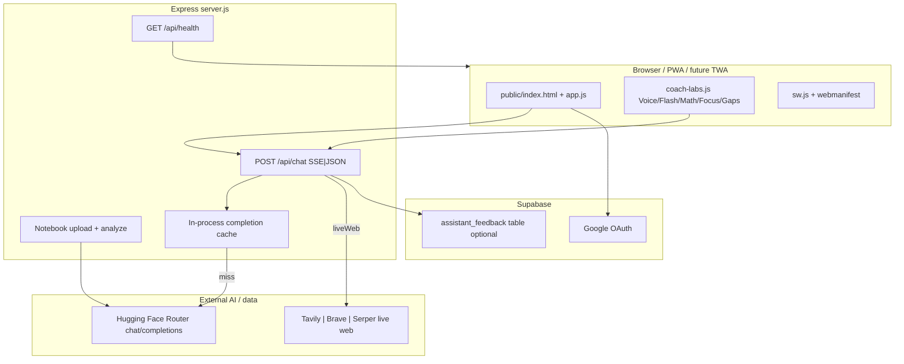

# Architecture Overview — My Student Coach

## System context

## Runtime building blocks

| Layer | Choice | Why |
|-------|--------|-----|
| UI | Vanilla SPA (no React runtime in production coach) | Fast load, simple deploy, full control of streaming UX |
| Auth | Supabase Google | Student-friendly SSO; no password DB |
| API | Node 18+ Express | Single process; easy Render blueprint |
| LLM | HF Inference Providers | Cost-flexible open models; OpenAI-compatible API |
| Docs | multer + pdf-parse | Notebook multi-file corpus |
| Voice | Web Speech STT/TTS + SSE speak-early | Ship conversational feel without native stack |
| Mobile | CSS Android shell + PWA | Play path via TWA later |

## Key request path (Ask stream)

1. Client `fetchAuthed('/api/chat', { stream: true, studyMode, learnerProfile, liveWeb? })`  
2. Server builds system = identity + response contract + mode style + UI language + learner profile (+ voiceMode / live web appendix).  
3. Cache lookup by hash; on miss, HF SSE proxied to client.  
4. Client renders tokens; optional Stop via `AbortController` (`activeChatAbort`).  
5. Optional thumbs → `/api/feedback`.

## Security / tenancy notes

- HF and Supabase **service** secrets stay on server / host env.  
- Frontend only holds Supabase anon key in `public/config.js`.  
- OAuth redirect allowlist is a launch gate (Safari pattern errors).  
- Honor-code modes constrain assistant behavior in prompt space (not a sandbox).
